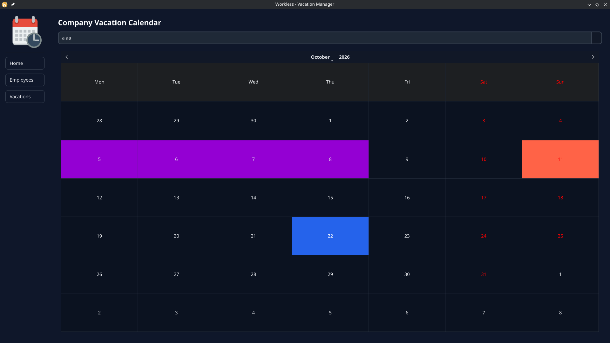
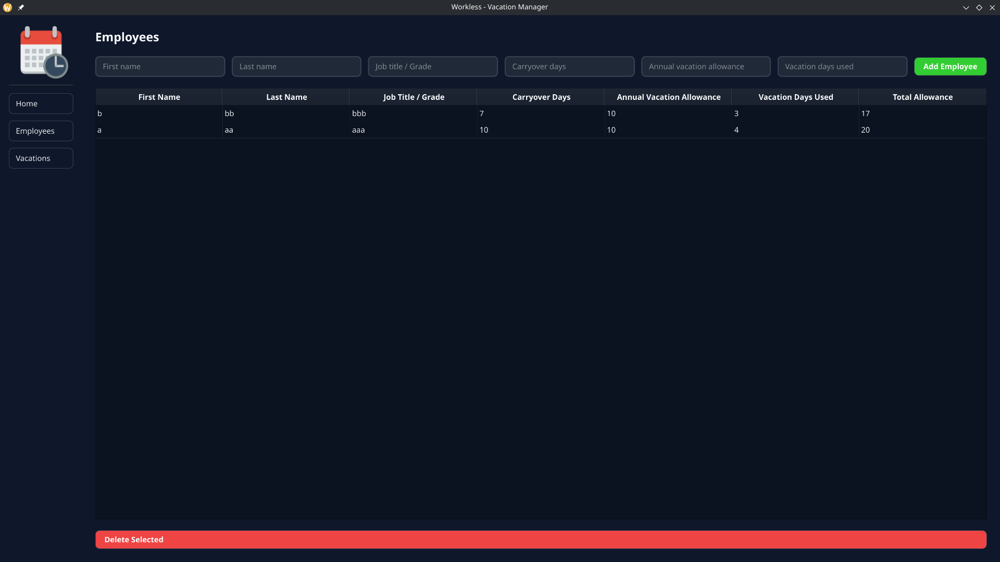
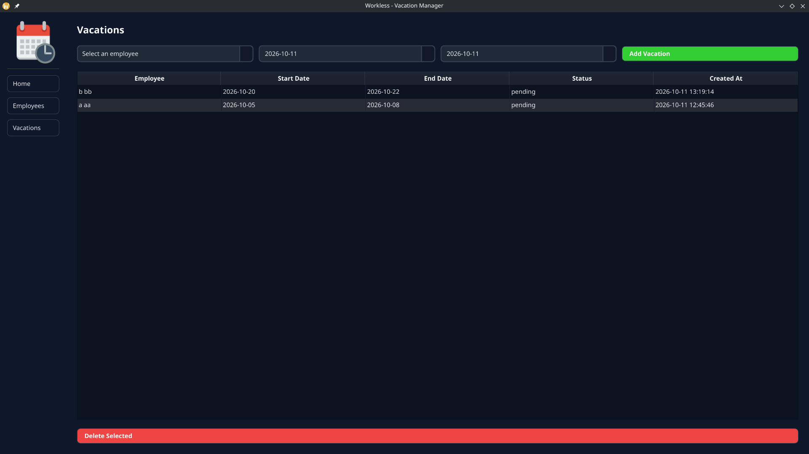

# vacation-manager

> A desktop application for managing employees and their vacation requests, built with Python, PyQt5, and SQLite.

## Overview

vacation-manager is a desktop application designed to simplify employee and vacation management for small organizations.

It provides a graphical interface for maintaining employee records, managing vacation periods, and visualizing absences through a calendar. Employee and vacation data are stored locally in an SQLite database.

The project uses a Model-View-Controller (MVC)-inspired structure to separate data access, application logic, and the graphical interface.

## Features

### Employee Management
- Add and manage employee records.
- Display employee information in a table.
- Edit employee information directly in the table.
- Delete selected employees.
- Track annual vacation credits, unused credits from the previous year, and vacation days used.
- Calculate the total available vacation credit.

### Vacation Management
- Select an employee when creating a vacation.
- Specify vacation start and end dates.
- Display registered vacations in a table.
- Delete selected vacation records with a confirmation dialog.
- Associate vacation records with employees in the database.

### Calendar and Interface
- Visualize vacation periods through a calendar interface.
- Navigate between the application's main sections.
- Apply custom CSS styling to the interface.
- Use a dedicated graphical interface instead of command-line interaction.

### Data Storage
- Store employee and vacation records in SQLite.
- Use relational database constraints to associate vacations with employees.
- Preserve records between application sessions when the database is stored at a persistent location.

## Screenshots

### Home and Calendar


### Employee Management


### Vacation Management



## Tech Stack

| Component | Technology |
|---|---|
| Programming language | Python |
| GUI framework | PyQt5 |
| Database | SQLite |
| Interface styling | CSS |
| Packaging | PyInstaller |
| Version control | Git |

## Architecture

vacation-manager follows an MVC-inspired architecture.

- **Model:** Handles database access and employee/vacation data operations.
- **View:** Displays the graphical interface, tables, forms, and calendar.
- **Controller:** Connects user interactions to model operations and refreshes the interface.

```text
User
 │
 ▼
View (PyQt5)
 │
 ▼
Controller
 │
 ▼
Model
 │
 ▼
SQLite Database
```

This separation makes the application easier to navigate and maintain by keeping interface code separate from database operations.

## Requirements

To run the application from source, you need:

- Python 3
- pip
- PyQt5

To package the application as a Windows executable, you also need PyInstaller.

## Installation

### 1. Clone the repository

Replace the repository URL below with the actual URL of your GitHub repository.

```bash
git clone ...
cd vacation-manager
```

### 2. Create a virtual environment

```bash
python3 -m venv .venv
```

Activate it on Windows:

```powershell
.venv\Scripts\Activate.ps1
```

Or, on Linux:

```bash
source .venv/bin/activate
```

### 3. Install dependencies

```bash
python3 -m pip install -r requirements.txt
```

If the requirements file does not include all required packages, install PyQt5 separately:

```bash
python3 -m pip install PyQt5
```

### 4. Launch the application

From the project root:

```bash
python3 -m src.main.main
```

The application initializes the database schema through its database module.

## Configuration

The application uses `config.py` for project configuration and `src/model/database.py` for database initialization and connections.

The SQLite database is located in:

```text
src/data/database.db
```

in the current source project structure.

**Note for packaged builds:** A database bundled inside a PyInstaller one-file executable should not be used as the writable database location. The executable extracts bundled resources to a temporary directory. For reliable persistence, the application should use a stable writable location, such as `%LOCALAPPDATA%\vacation-manager\database.db` on Windows.

## Usage

1. Launch vacation-manager.
2. Open the Employees section.
3. Add an employee and enter their information.
4. Edit employee details directly in the table when needed.
5. Open the Vacations section.
6. Select an employee and specify the vacation dates.
7. Create the vacation record.
8. Review employee absences through the vacation table and calendar.
9. Select records and use the available deletion actions when necessary.

## Testing

Automated tests are not currently documented in this repository.

The following manual checks are recommended when validating a build:

- [ ] Launch the application successfully.
- [ ] Add, edit, and delete employee records.
- [ ] Verify that vacation credits are displayed correctly.
- [ ] Create and delete vacation records.
- [ ] Check that vacations are associated with the correct employees.
- [ ] Verify that the calendar reflects the expected vacation periods.
- [ ] Close and reopen the application and confirm that data persists.
- [ ] Test the packaged executable independently of the development environment.

## Project Structure

```text
vacation-manager/
├── assets/
│   ├── icon.png
├── src/
│   ├── controller/
│   │   ├── __init__.py
│   │   ├── employee_controller.py
│   │   └── vacation_controller.py
│   ├── data/
│   │   └── database.db
│   ├── main/
│   │   └── main.py
│   ├── model/
│   │   ├── __init__.py
│   │   ├── database.py
│   │   ├── employee_model.py
│   │   └── vacation_model.py
│   ├── style/
│   │   ├── calendar_style.css
│   │   ├── employee_style.css
│   │   ├── home_style.css
│   │   └── vacation_style.css
│   └── view/
│       ├── calendar_view.py
│       ├── employee_view.py
│       ├── home_view.py
│       └── vacation_view.py
├── config.py
├── requirements.txt
├── README.md
└── .gitignore
```

The project also uses a PyInstaller specification file when configured for executable packaging.

## Development

### Run from source

Activate the virtual environment, install the dependencies, and run:

```bash
python3 -m src.main.main
```

### Build an executable

Build using the PyInstaller specification file:

```bash
python3 -m PyInstaller --clean --noconfirm --distpath bin vacman.spec
```

The generated executable is placed in `bin/`. PyInstaller builds for the operating system on which it runs; building on Linux produces a Linux executable, not a Windows `.exe`.

For debugging, enable the console in the PyInstaller configuration temporarily so that Python exceptions are visible. Disable it again for a normal GUI release.

Before distributing a build, verify that all required stylesheets and icons are included, the database uses a persistent writable location, and employee and vacation operations work after restarting the executable.

## Design Decisions

### SQLite for local storage

SQLite provides a lightweight relational database without requiring a separate database server. It suits a small desktop application where employee and vacation records need to be stored locally.

### MVC-inspired organization

Separating models, views, and controllers helps isolate database operations from the interface and user interactions.

### PyQt5 for the graphical interface

PyQt5 provides the widgets, tables, forms, dialogs, and calendar-related interface components needed for a desktop management application.

### PyInstaller for distribution

PyInstaller packages the Python application and its dependencies into a Windows executable, allowing users to launch the application without manually setting up the Python environment.

## Limitations

- The application is designed primarily for local desktop use.
- User authentication and role-based access control are not implemented.
- SQLite storage is local rather than a shared, centralized database.
- Automated test coverage is not yet documented.
- Database schema consistency and persistent storage paths must be verified when packaging or upgrading the application.
- The packaged application currently targets Windows distribution; other platforms may require separate packaging and testing.

## Roadmap

- [x] Employee management interface.
- [x] Vacation management interface.
- [x] SQLite database integration.
- [x] Calendar and custom interface styling.
- [x] Initial Windows executable packaging.
- [ ] Add automated tests for employee and vacation operations.
- [ ] Make database storage persistent and reliable across packaged application restarts.
- [ ] Add database schema migrations.
- [ ] Improve packaging and release documentation.
- [ ] Add screenshots and a demonstration to the README.

## Contributing

Contributions, bug reports, and suggestions are welcome.

1. Fork the repository.
2. Create a branch for your changes.
3. Make and test your changes.
4. Commit your work with a descriptive message.
5. Open a pull request describing the changes.

If a `CONTRIBUTING.md` file is added later, refer to it here for detailed contribution guidelines.

## License

This project is under MIT license, see `LICENSE`